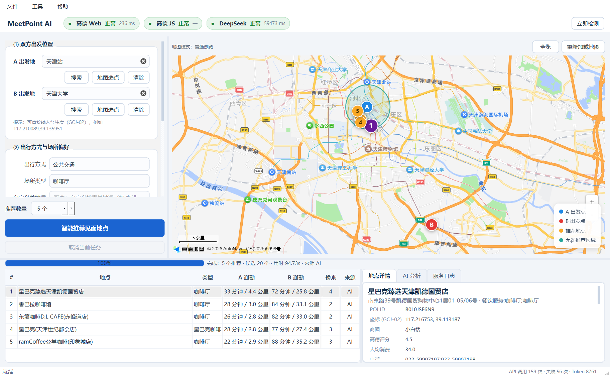
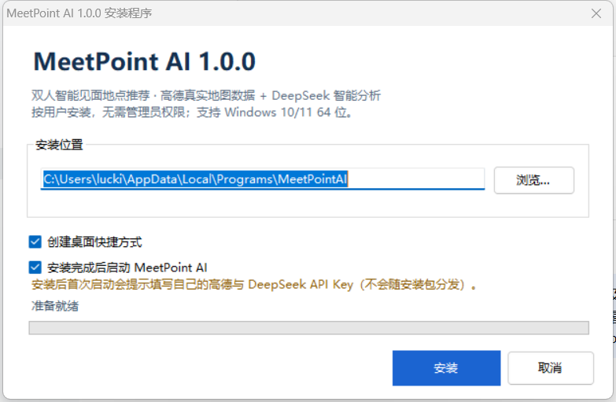

# MeetPointAI
配置高德地图的API及DeepSeek的API后给A、B两点及需求可以决定去哪见面

你和对方分别在城市的不同位置，想约一个「双方都方便、又符合偏好」的见面地点？
MeetPoint AI 用真实地图数据找出候选地点，用 DeepSeek 比较并给出推荐理由，再由程序做范围与路线校验——**不会编造地点，也不会推荐到区域外**。



---

## 目录

- [功能亮点](#功能亮点)
- [系统要求](#系统要求)
- [安装与卸载](#安装与卸载)
- [首次配置（必读）](#首次配置必读)
- [使用步骤](#使用步骤)
- [推荐模式与范围约束](#推荐模式与范围约束)
- [常见问题](#常见问题)
- [隐私与安全](#隐私与安全)
- [从源码构建](#从源码构建)
- [技术栈](#技术栈)
- [许可与致谢](#许可与致谢)

---

## 功能亮点

| 能力 | 说明 |
| --- | --- |
| 三种设点方式 | 输入地点名/地址、地图点击（可拖动）、直接输入经纬度（GCJ-02） |
| 同名地点确认 | 搜索到多个同名 POI 时弹出候选列表，由你选定 |
| 圆形范围 | 在地图上点圆心 + 输入半径（支持**千米/米**），可拖动调整 |
| 多边形范围 | 连续点击绘制、双击闭合、拖动顶点编辑；自相交会被拒绝 |
| 真实路线 | 公共交通 / 驾车 / 步行 / 骑行，A、B 两侧分别规划，显示时间、换乘、步行距离 |
| AI 推荐 | DeepSeek 只做比较与解释；返回结果由程序二次校验 |
| 5 种推荐模式 | AI 综合推荐、最短总通勤时间、最少换乘、场所类型优先、自然语言自定义 |
| 三路健康监测 | 高德 Web 服务 / 高德 JS API / DeepSeek 独立状态与降级，绝不假装成功 |
| 结果可导出 | 一键导出 JSON（含双方路线与理由），双击结果可直接打开高德导航 |
| 应用内设置 | 工具 → 设置（Ctrl+,）可改 Key、模型、推荐数量、超时等，保存即生效 |

---

## 系统要求

- **操作系统**：Windows 10 1809 及以上 / Windows 11
- **架构**：**仅 64 位（x64）**
- 内存 4 GB 以上，磁盘 1 GB（安装后约 450 MB）
- 可访问 `restapi.amap.com`、`webapi.amap.com`、`api.deepseek.com` 的网络

> **关于 32 位（x86）Windows**：本程序基于 Qt 6 / PySide6 与 Chromium 内核的地图组件，
> Qt 6 已不再提供 32 位 Windows 构建，因此无法生成可用的 x86 版本安装包。
> 安装程序检测到 32 位系统会直接提示并退出，不会留下半安装状态。
> 若必须在 32 位系统使用，只能改用旧版 Qt5 技术栈重写，不在本版本范围内。

---

## 安装与卸载

### 安装

1. 双击 `MeetPointAI-Setup-1.0.0-win64.exe`；
2. 选择安装位置（默认 `%LOCALAPPDATA%\Programs\MeetPointAI`，**按用户安装，不需要管理员权限**）；
3. 点击「安装」，完成后可在开始菜单 / 桌面找到 **MeetPoint AI**；
4. 首次启动会提示配置 API Key（见下一节）。



> 静默安装：`MeetPointAI-Setup-1.0.0-win64.exe /S /D=D:\Apps\MeetPointAI`
> 静默卸载：`"%LOCALAPPDATA%\Programs\MeetPointAI\Uninstall.exe" /S`

### 卸载

- 「设置 → 应用 → 已安装的应用 → MeetPoint AI → 卸载」，或
- 开始菜单 → MeetPoint AI → 卸载，或直接运行安装目录下的 `Uninstall.exe`。

卸载会删除程序目录与快捷方式；`%LOCALAPPDATA%\MeetPointAI`（配置、缓存、日志）会保留，如需彻底清理请手动删除该目录。

### 便携使用

安装目录可整体复制到 U 盘/其他电脑直接运行（同目录不要带他人的 `.env`）。
程序数据默认写在 `%LOCALAPPDATA%\MeetPointAI`。

---

## 首次配置（必读）

程序**不内置任何 API Key**，需要你自己申请（都有免费额度）：

| 需要的凭据 | 申请地址 | 用途 |
| --- | --- | --- |
| 高德 **Web 服务** Key | <https://console.amap.com/dev/key/app> | 地点搜索、地理编码、路线规划 |
| 高德 **Web端(JS)** Key + 安全密钥 | 同上（新增一个 Key，平台选「Web端(JS)」） | 内嵌地图、绘制范围 |
| **DeepSeek** API Key | <https://platform.deepseek.com/api_keys> | 候选比较与推荐理由 |

申请高德 Key 时注意：**Web 服务 Key 与 JS Key 不能混用**；JS Key 的域名白名单建议留空。

### 填写方式（推荐）

启动程序 →「工具 → 设置…」（Ctrl+,）→ **API 凭据** 页填写四项 →「保存并应用」。
保存后程序会立即重建服务并自动检测，顶部三个状态胶囊变绿即可使用。

- 配置写入 `安装目录\.env`；若安装目录只读，则自动写入 `%LOCALAPPDATA%\MeetPointAI\.env`。
- 界面中 Key 默认以密码显示，可勾选「显示明文 Key」核对。
- 日志与界面均只显示脱敏后的 Key。

### 也支持手动 `.env`

在安装目录或 `%LOCALAPPDATA%\MeetPointAI\` 下新建 `.env`：

```ini
AMAP_WEB_KEY=你的Web服务Key
AMAP_JS_KEY=你的JS_Key
AMAP_JS_SECURITY_CODE=你的JS安全密钥
DEEPSEEK_API_KEY=sk-你的Key
DEEPSEEK_MODEL=deepseek-v4-pro
```

保存后重启程序。

---

## 使用步骤

1. **设置 A、B 位置**：输入「天津站」→ 搜索（多个结果会让你确认）；或点「地图选点」后在地图上单击；或直接输入 `经度,纬度`。
2. **选择出行方式与偏好**：公共交通/驾车/步行/骑行；场所类型；推荐模式；可写自然语言偏好（如「安静、人均 80 以内、离地铁近」）。
3. **限制推荐区域（可选但推荐）**：选「圆形区域」→「地图选圆心」→ 调半径；或「绘制多边形」→ 连续点击 → 双击闭合。
4. **调整推荐数量**：按钮上方「推荐数量」1–10。
5. **点击「智能推荐见面地点」**：进度条会显示分块检索 → 路线规划 → AI 分析。
6. **查看结果**：列表显示双方通勤与换乘；单击某行地图上画出双方路线并显示详情/理由/导航链接；「文件 → 导出当前推荐结果」可保存 JSON。

---

## 推荐模式与范围约束

| 模式 | 排序依据 |
| --- | --- |
| AI 综合推荐 | DeepSeek 结合偏好、类型、通勤、换乘、步行、评分等综合比较（结果须通过程序校验） |
| 最短总通勤时间 | A、B 通勤时间之和最小 |
| 最少换乘 | 双方换乘次数最少，其次看总时长 |
| 指定场所类型优先 | 命中类型优先，其次看总时长 |
| 自然语言自定义 | 交给 AI 理解你的描述后比较 |

**范围是硬约束**：候选地点必须位于你画的圆/多边形内（边界算内），AI 无权扩大范围；
区域内没有合格地点时，程序会提示「请扩大搜索范围或调整场所偏好」，不会用区域外的地点凑数。

已经取消「公平性评分」：不会为了"对双方一样公平"而牺牲实际通勤时间，但仍会展示双方各自的预计通勤时间。

---

## 常见问题

**Q：提示「高德 Web 服务 鉴权失败」？**
检查是否把 JS Key 填到了 Web 服务位置（反之亦然），以及 Key 是否已启用「Web服务」平台。

**Q：状态显示「配额受限」？**
高德免费额度按日计算，单次 3 km 圆形推荐约消耗 80–120 次调用。可缩小半径、减少推荐数量，或次日再试。

**Q：DeepSeek 状态「延迟较高」？**
推理模型单次比较可能耗时 20–70 秒，属正常范围；可在设置里把推理强度调为「低」、或把模型换成 `deepseek-flash`。

**Q：公共交通显示「步行替代」？**
小于 2.5 km 的行程通常没有公交方案，程序会自动改用真实步行路线并注明。

**Q：地图白屏/加载失败？**
点顶部「重新加载地图」；仍失败请检查网络/代理能否访问 `webapi.amap.com`，并确认 JS Key 与安全密钥正确。

**Q：想换电脑使用？**
把安装目录复制过去，再在新电脑的「工具 → 设置」里填一次 Key（或复制 `.env`）。

**Q：日志在哪？**
`%LOCALAPPDATA%\MeetPointAI\logs\meetpoint.log`（自动脱敏，不含 Key）。

**Q：如何清空本地数据？**
「文件 → 清除历史数据与缓存」，或删除 `%LOCALAPPDATA%\MeetPointAI`。

---

## 隐私与安全

- 不收集任何遥测；所有请求只发往高德与 DeepSeek 官方域名。
- API Key 只保存在本机 `.env`，界面/日志仅显示脱敏形式，不会上传到任何第三方。
- 精确位置不默认长期保存；缓存可一键清除。
- 地图页使用内存缓存并禁用持久化 Cookie。
- 发送给 DeepSeek 的内容仅限候选名称、类型、评分与通勤摘要等必要字段。

---

## 从源码构建

源码包：`MeetPointAI-1.0.0-source.zip`（不含任何 Key）

```powershell
# 1) 解压后进入目录
python -m venv .venv
.\.venv\Scripts\python.exe -m pip install -U pip
.\.venv\Scripts\python.exe -m pip install -r requirements.txt

# 2) 配置
copy .env.example .env      # 填入自己的 Key，或启动后在界面里填

# 3) 运行
.\.venv\Scripts\python.exe main.py

# 4) 测试
.\.venv\Scripts\python.exe -m pytest -q

# 5) 打包 EXE
.\.venv\Scripts\pyinstaller.exe meetpoint.spec --noconfirm
```

目录说明：

```
main.py                 入口（--self-test 自检 / --screenshot 截图）
config/                 配置与常量        models/    Pydantic 模型
geometry/               坐标与区域算法    services/  高德 / DeepSeek / HTTP
algorithms/             候选检索、排序、AI 校验、主流程
monitoring/             三路健康状态机    storage/   SQLite 缓存与日志
ui/                     PySide6 界面 + 高德 JS 地图页
tests/                  99 个单元/集成测试
scripts/                联调、探针、截图脚本
docs/                   架构、API 配置、测试手册
```

---

## 技术栈

- Python 3.12 · PySide6 6.8（Qt Widgets + QtWebEngine）· Qt WebChannel
- 高德地图 JavaScript API 2.0 + Web 服务 API（POI / 地理编码 / 4 种路径规划）
- DeepSeek Chat Completions（JSON 输出、Pydantic 校验）
- Shapely（多边形包含判断，局部等距投影）· httpx（异步连接池）· SQLite · PyInstaller

---

## 许可与致谢

- 本程序代码以 PolyForm Noncommercial 1.0.0 发布，欢迎学习与二次开发，禁止商业使用。
- 地图数据与路线来自 **高德开放平台**，请遵守其服务条款与配额限制。
- 智能分析由 **DeepSeek** 提供，请遵守其使用条款。
- 界面基于 **Qt for Python (PySide6)**，遵循 LGPLv3。

> 使用前请自行申请并妥善保管 API Key；因 Key 泄露或超额调用产生的费用与责任由使用者承担。
