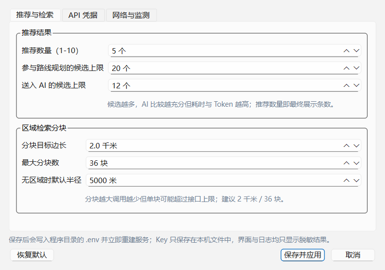

# MeetPoint AI · V0.0.0.1

**双人智能见面地点推荐 · Windows 桌面版**

你和对方分别在城市的不同位置，想约一个「双方都方便、又符合偏好」的见面地点？
MeetPoint AI 用高德地图的真实 POI 与路线数据找出候选，用 DeepSeek 比较并给出推荐理由，再由程序做范围与路线硬校验——**不编造地点（POI/坐标/路线全部来自高德），也不把推荐放到你画的区域外**。


> 上图来自本版真实界面：A=天津站、B=天津大学（卫津路校区）、3 km 圆形区域、咖啡厅偏好、公共交通；
> 结果列表用**同比例的通勤对比条**显示 A/B 两端时长，右侧是选中地点的详情与双方路线。

---

## 目录

- [1. 系统要求](#1-系统要求)
- [2. 安装、升级与卸载](#2-安装升级与卸载)
- [3. 首次配置（必读）](#3-首次配置必读)
- [4. 界面与使用步骤](#4-界面与使用步骤)
- [5. 推荐模式与范围约束](#5-推荐模式与范围约束)
- [6. 命令行工具 meetpoint-debug](#6-命令行工具-meetpoint-debug)
- [7. 候选池诊断与告警](#7-候选池诊断与告警)
- [8. Record / Replay 与离线运行](#8-record--replay-与离线运行)
- [9. 断供与降级行为](#9-断供与降级行为)
- [10. 测试与验证](#10-测试与验证)
- [11. V0.0.0.1 相对上一版改了什么](#11-v0001-相对上一版改了什么)
- [12. 常见问题](#12-常见问题)
- [13. 隐私与安全](#13-隐私与安全)
- [14. 目录结构](#14-目录结构)
- [15. 从源码构建](#15-从源码构建)
- [16. 技术栈](#16-技术栈)
- [17. 许可与致谢](#17-许可与致谢)

---

## 1. 系统要求

- **操作系统**：Windows 10 1809 及以上 / Windows 11
- **架构**：**仅 64 位（x64）**
- 内存 4 GB 以上；磁盘 1 GB（安装后约 450 MB）
- 网络可访问 `restapi.amap.com`、`webapi.amap.com`、`api.deepseek.com`

> **关于 32 位（x86）Windows**：程序基于 Qt 6 / PySide6 与 Chromium 内核的 QtWebEngine，Qt 6 已不再提供 32 位 Windows 构建，
> 因此无法产出可用的 x86 安装包。安装程序在 32 位系统上会直接提示并退出，不会留下半安装状态。

---

## 2. 安装、升级与卸载

### 安装

1. 双击 `MeetPoint-AI-Setup-V0.0.0.1-win-x64.exe`；
2. 安装位置默认 `%LOCALAPPDATA%\Programs\MeetPoint AI`（**按用户安装，不需要管理员权限**）；
3. 安装完成后从开始菜单（或桌面快捷方式，安装时勾选）启动 **MeetPoint AI**；
4. 首次启动会提示配置 API Key，见 [第 3 节](#3-首次配置必读)。

```powershell
# 静默安装到指定目录（Inno Setup 参数）
.\MeetPoint-AI-Setup-V0.0.0.1-win-x64.exe /VERYSILENT /SUPPRESSMSGBOXES /NORESTART /DIR="D:\Apps\MeetPoint AI"

# 静默卸载
& "$env:LOCALAPPDATA\Programs\MeetPoint AI\unins000.exe" /VERYSILENT /SUPPRESSMSGBOXES
```

### 升级

覆盖安装即可：安装程序只替换程序文件，`%LOCALAPPDATA%\MeetPointAI`（配置、缓存、日志、运行记录）会保留。
若从旧版升级后地图或接口异常，先「工具 → 立即检测 API 状态」，再到「工具 → 设置…」确认 4 个 Key 仍在。

### 卸载

- 「设置 → 应用 → 已安装的应用 → MeetPoint AI → 卸载」，或
- 开始菜单 → MeetPoint AI → 卸载，或运行安装目录下的 `unins000.exe`。

卸载会移除程序目录与快捷方式；`%LOCALAPPDATA%\MeetPointAI`（`.env`、缓存、日志）会保留，需要彻底清理时手动删除该目录。

### 便携使用

安装目录可整体复制到 U 盘或另一台电脑直接运行（同目录不要带他人的 `.env`）。
程序数据默认写在 `%LOCALAPPDATA%\MeetPointAI`，可用环境变量 `MPAI_DATA_DIR` 改到别处。

---

## 3. 首次配置（必读）

程序**不内置任何 API Key**，需要自己申请（均有免费额度）：

| 需要的凭据 | 申请地址 | 用途 |
| --- | --- | --- |
| 高德 **Web 服务** Key | <https://console.amap.com/dev/key/app> | 地点搜索、地理编码、路径规划 |
| 高德 **Web端(JS)** Key + 安全密钥 | 同上（另建一个 Key，平台选「Web端(JS)」） | 内嵌地图、绘制圆形/多边形 |
| **DeepSeek** API Key | <https://platform.deepseek.com/api_keys> | 候选比较与推荐理由 |

申请高德 Key 时注意：**Web 服务 Key 与 JS Key 不能混用**；JS Key 的域名白名单建议留空。

### 填写方式（推荐）

启动程序 →「工具 → 设置…」（`Ctrl+,`）→ **API 凭据** 页填写四项 →「保存并应用」。
保存后程序立即重建服务并自动检测，顶栏三个状态点变绿即可使用。



- 设置窗口分三页：**推荐与检索**（推荐数量 1–10、参与路线规划的候选上限、每批送入 AI 的候选上限、分块目标边长、最大分块数、无区域时默认半径）、**API 凭据**、**网络与监测**（超时、延迟阈值、健康检测间隔）。
- 配置优先写入**程序目录** `.env`；程序目录只读时写入 `%LOCALAPPDATA%\MeetPointAI\.env`。
- Key 默认以密码框显示，可勾选「显示明文 Key」核对；界面与日志只显示脱敏形式。

### 也支持手动 `.env`

在程序目录或 `%LOCALAPPDATA%\MeetPointAI\` 下新建 `.env`（模板即安装目录里的 `.env.example`）：

```ini
AMAP_WEB_KEY=你的Web服务Key
AMAP_JS_KEY=你的JS_Key
AMAP_JS_SECURITY_CODE=你的JS安全密钥
DEEPSEEK_API_KEY=sk-你的Key
DEEPSEEK_BASE_URL=https://api.deepseek.com
DEEPSEEK_MODEL=deepseek-v4-pro
```

### 可调项（环境变量 / `.env`）

| 变量 | 默认 | 作用 |
| --- | --- | --- |
| `MPAI_TOP_N` | `5` | 最终推荐条数（1–10） |
| `MPAI_MAX_CANDIDATES` | `30` | 参与路线规划的候选上限（3–80） |
| `MPAI_AI_CANDIDATES` | `30` | 每批送入 DeepSeek 的候选上限（3–80） |
| `MPAI_TILE_KM` | `2.0` | 分块检索目标边长（千米），调大省调用、调小更细 |
| `MPAI_MAX_TILES` | `36` | 分块数**硬上限**，圆形/多边形都不会超发 |
| `MPAI_SEARCH_RADIUS` | `5000` | 无区域时默认搜索半径（米） |
| `MPAI_HTTP_TIMEOUT` / `MPAI_CONNECT_TIMEOUT` | `12` / `5` | 高德请求超时（秒） |
| `MPAI_LLM_TIMEOUT` | `120` | DeepSeek 单次对话超时（秒） |
| `MPAI_LLM_EFFORT` | `low` | 推理强度 `low/high/max`，越低越快越省 |
| `MPAI_LATENCY_WARN_MS` / `MPAI_LLM_LATENCY_WARN_MS` | `2500` / `60000` | 判定「延迟较高」的阈值（毫秒） |
| `MPAI_HEALTH_INTERVAL` | `60` | 周期健康检测间隔（秒），`0` 关闭 |
| `MPAI_MAX_CONCURRENCY` / `MPAI_MAX_RETRIES` | `4` / `2` | 路线并发与重试次数 |
| `MPAI_DATA_DIR` | 空 | 留空则用 `%LOCALAPPDATA%\MeetPointAI` |

---

## 4. 界面与使用步骤

1. **设置 A、B 位置**：输入「天津站」→「搜索」（多个同名结果会弹出候选列表让你确认）；
   或点「在地图上选点」后在地图上单击；也可直接输入 `经度,纬度`（GCJ-02）。
2. **选择出行方式与偏好**：公共交通 / 驾车 / 步行 / 骑行；场所类型；推荐模式；可写自然语言偏好（如「安静、适合聊天、人均 80 元以内、最好离地铁近」）。
3. **限制推荐区域（可选但推荐）**：区域限制选「圆形区域」→「在地图上选圆心」→ 调半径（支持**千米/米**切换，数值自动换算）；
   或「绘制多边形」→ 连续点击 → 双击闭合 → 拖动顶点微调。自相交会被直接拒绝。
4. **调整推荐数量**：左栏底部「推荐数量」1–10 即时生效。
5. **点「开始推荐」**：标题下的 3px 进度线 + 状态栏文案显示分块检索 → 路线规划 → AI 分析；随时可「取消当前任务」。
6. **看结果**：列表显示 A/B 通勤、总时长、换乘（0 次写作「直达」）；单击某行地图画出双方路线，右侧切换到 **地点详情 / AI 分析 / 服务日志**；
   双击结果直接用高德打开；「文件 → 导出当前推荐结果…」可保存 JSON。

菜单与快捷键：

| 菜单 | 项目 | 说明 |
| --- | --- | --- |
| 文件 | 清除历史数据与缓存 | 一次性删除缓存、会话、健康日志 |
| 文件 | 导出当前推荐结果… | 导出含双方路线与理由的 JSON |
| 工具 | 设置…（`Ctrl+,`） | Key、模型、推荐/检索参数、超时与健康检测 |
| 工具 | 立即检测 API 状态 | 手动触发三路健康探测 |
| 工具 | 重新加载地图 | JS API 白屏/超时时的恢复入口 |
| 帮助 | 关于 MeetPoint AI | 版本与致谢 |

顶栏常驻 **高德 Web 服务 / 高德 JS API / DeepSeek** 三个状态点与延迟，异常时给出具体原因；
底部状态栏实时显示本次运行的 **API 调用次数 · 失败次数 · Token 消耗**。

---

## 5. 推荐模式与范围约束

| 模式 | 排序依据 |
| --- | --- |
| AI 综合推荐 | DeepSeek 结合偏好、类型、通勤、换乘、步行、评分等综合比较（结果必须通过程序校验） |
| 地点品质优先（最短总通勤） | 总通勤时间升序，换乘与长距离步行有小权重惩罚 |
| 最少换乘 | 双方换乘次数优先，其次看总时长 |
| 指定场所类型优先 | 命中类型优先，其次看总时长 |
| 自然语言自定义需求 | 交给 AI 理解你的描述后比较 |

**范围是硬约束**：候选地点必须位于你画的圆 / 多边形内（**边界算在内**），AI 无权扩大范围；
区域内没有合格地点时，程序明确提示「当前指定区域内未找到符合条件的见面地点，请扩大搜索范围或调整场所偏好」，**不会**用区域外的地点凑数。

- 圆形：haversine 球面距离判断；多边形：局部等距投影 + Shapely `covers`（支持凹多边形、拒绝自相交）。
- 每个最终结果都会**再复验一次**区域与坐标归属，日志里可见「区域硬约束校验：通过」。
- 已取消「公平性评分」：不会为了「对双方一样公平」而牺牲真实通勤时间；两端时长并排展示，由你判断。
- 任一侧不可达的候选一律剔除，不进入最终列表。

---

## 6. 命令行工具 meetpoint-debug

本版新增的独立 CLI 与 GUI **共用同一套引擎**（`algorithms/`、`geometry/`、`services/`、`monitoring/`），没有另写一套推荐逻辑；
适合批量验证、问题复现与自动化回归。

```powershell
# 安装目录里的独立 CLI（无需本机 Python）
& "$env:LOCALAPPDATA\Programs\MeetPoint AI\meetpoint-debug.exe" --help

# 源码目录里运行
.\.venv\Scripts\python.exe meetpoint_debug.py --help
```

| 命令 | 作用 | 是否联网 |
| --- | --- | --- |
| `health` | 三路服务与模型状态 | 仅 `--live` |
| `search` | 完整推荐流程（与 GUI 相同） | `--live` 时联网，默认 mock |
| `candidates` | 只做 POI 检索 + 去重 + 区域过滤 | 同上 |
| `routes` | 候选 + A/B 路线规划 | 同上 |
| `diagnose` | 完整诊断（阶段计数 / 淘汰原因 / 耗时 / 缓存） | 同上 |
| `validate` | 校验已有结果是否满足区域、坐标、数量约束 | 否 |
| `benchmark` | 批量跑套件并汇总 | 取决于参数 |
| `history` | 查看历史运行（Run ID） | 否 |
| `report --run-id` | 导出某次运行的完整报告 | 否 |

```powershell
# 离线合成数据跑完整推荐（不消耗任何配额）
.\meetpoint-debug.cmd search --config cases\basic.json --json

# 真实 API + 录制
.\meetpoint-debug.cmd search --config cases\basic.json --live --record data\recordings --json

# 严格离线回放（任何网络请求都会被拦下）
.\meetpoint-debug.cmd search --config cases\basic.json --replay data\recordings --ai recorded --offline --json

# 只看候选池 / 完整诊断 / 校验结果 / 批量基准
.\meetpoint-debug.cmd candidates --config cases\basic.json --json
.\meetpoint-debug.cmd diagnose  --config cases\basic.json --json
.\meetpoint-debug.cmd validate  --config cases\basic.json --result out\result.json --json
.\meetpoint-debug.cmd benchmark --suite suites\smoke.json --json
```

通用参数：`--config`（用例 JSON）、`--json`（stdout 纯 JSON，进度与日志走 stderr）、`--out`、`--live`、`--mock`、`--replay`、`--offline`、
`--record`、`--ai recorded|live|mock`、`--top-n 1~10`、`--max-api-calls`、`--max-tokens`、`--timeout`、`--runs-dir`、`--quiet`、`--verbose`；
越界数值按**用法错误**处理，不会被静默忽略。

**JSON 输出契约**（所有命令一致）：

```json
{
  "schema_version": "1.0",
  "tool": "meetpoint-debug",
  "tool_version": "1.0.0",
  "run_id": "run-20261025-200255-e06c3a",
  "status": "ok",
  "command": "search",
  "started_at": "2026-10-25T20:02:55+00:00",
  "elapsed_ms": 11234,
  "data": { },
  "warnings": [{ "code": "CANDIDATES_TRUNCATED", "message": "..." }],
  "errors": [],
  "stats": { "api_calls": 54, "api_failures": 0, "tokens": 4050 }
}
```

- `status`：`ok` / `no_result` / `failed` / `cancelled`
- 退出码：`0` 成功、`1` 失败、`2` 用法或配置错误、`3` 业务无结果、`130` 用户取消
- stdout 只有 JSON（含 argparse 用法报错时的错误信封），stderr 才是人读日志；`--out` 写入失败只告警、不改变退出码
- `tool_version` 是**契约版本**（1.0.0），与产品版本号 `V0.0.0.1` 各自独立演进

---

## 7. 候选池诊断与告警

每次 `search` / `diagnose` / `candidates` / `routes` 都会记录完整漏斗：

```
raw（高德原始）→ deduped（去重）→ in_region（区域内）→ routed（双方可达）
→ preselected（进入排序）→ ai_input（送 DeepSeek）→ ai_output（AI 返回）→ final（最终推荐）
```

- 每个被淘汰的候选都带**阶段 + 原因**（`dedupe` / `region` / `preselect` / `route` / `ai_validate` / `final`），附 ID、名称与坐标。
- 自动告警码：`CANDIDATES_TRUNCATED`（候选被上限截断）、`LOW_COVERAGE`（区域内候选过少）、`SEARCH_BUDGET_HIT`（检索预算用尽）、
  `AI_POOL_TRUNCATED`（AI 输入候选被单独限制）、`ROUTE_API_FAILURE`（路线接口失败）、`AI_FALLBACK` / `AI_INVALID`（AI 降级）。
- **分块按页轮转**：先取各块第一页，再按预算补后续页，避免只查前几个网格。
- 去重：POI ID + (名称, 50 m 网格) 双键；坏记录（缺 ID/坐标）跳过并计入统计，不中断整次检索。
- 覆盖指标（占用格数、覆盖比、分布跨度、类型多样性）明确标注为**启发式指标**，不代表全区域真实召回率。

典型用法：对比同一次运行的 `in_region` 与 `ai_input`，即可区分「推荐波动」是检索覆盖不足、候选被过早截断，还是 AI 排序问题。

---

## 8. Record / Replay 与离线运行

- 录制内容：用例配置、高德每次请求的参数与响应、DeepSeek 输入与输出、耗时与错误；**不含 Key、不含请求头**。
- 文件带 `schema_version` 与 `data_version`，版本不匹配会明确报 `RECORDING_VERSION_MISMATCH`。
- `--replay --ai recorded` 完整复现历史结果；`--ai mock` 用同一份高德数据比较「另一种排序」；`--ai live` 只重跑 AI。
- `--offline` 在任何网络请求前拦截（与 `--live` 同时给会报 `OFFLINE_CONFLICT`，退出码 2）。
- AI 响应按**请求指纹精确匹配**：找不到对应响应就报错，不会拿别的候选批次冒充。

---

## 9. 断供与降级行为

| 故障 | 行为 |
| --- | --- |
| DeepSeek 不可用 | 地图、检索、路线全部可用；自动切到本地规则排序，界面提示「AI 服务不可用，当前为基础推荐模式」 |
| 高德 Web 服务不可用 | 禁止生成未经验证的新地点/路线；「开始推荐」禁用并提示「地图数据服务不可用」；缓存路线标注缓存时间，不当实时数据 |
| 高德 JS API 不可用 | 地图区显示加载失败/超时原因，提供「重新加载地图」；文字地址输入、搜索与推荐仍可用 |
| 两者同时不可用 | 不产生任何推荐，只给故障说明与重试入口 |
| 取消任务 | 只取消**当前**任务；不会被误报成服务故障，也不会把旧任务的进度/结果写回界面 |

---

## 10. 测试与验证

```powershell
cd .\MeetPoint-AI-0.0.0.1

# 1) 单元 + 集成测试（无需网络、无需 Key）
.\.venv\Scripts\python.exe -m pytest -q

# 2) 真实 API 端到端（消耗少量高德配额与 DeepSeek Token）
.\.venv\Scripts\python.exe scripts\live_check.py

# 3) 高德 JS API 探针（QWebEngine 内真实加载地图）
.\.venv\Scripts\python.exe scripts\js_probe.py

# 4) 无界面 GUI 冒烟 + 截图
.\.venv\Scripts\python.exe scripts\gui_smoke.py

# 5) 输入/单位/设置回归
.\.venv\Scripts\python.exe scripts\ui_check.py
```

- 本目录源码实测：**`224 passed`**（17 个测试文件，含 CLI 契约、Record/Replay、预算与超时、几何边界、API 故障、排序与校验、存储、回归用例；源码包已含 `tests\data\small_case.json` 用例样本）。
- 真实链路参考值（天津站 → 天津大学，3 km 圆形 + 咖啡厅）：36 分块 / 64 次调用 / 1275 条原始 / 551 去重 / 445 区域内 / 20 候选 / `source=ai`。
- 打包产物自检与截图：

```powershell
& "$env:LOCALAPPDATA\Programs\MeetPoint AI\MeetPoint AI.exe" --self-test
# 结果写入 %LOCALAPPDATA%\MeetPointAI\self_test.json，全部通过时退出码 0

& "$env:LOCALAPPDATA\Programs\MeetPoint AI\MeetPoint AI.exe" --screenshot "$env:TEMP\mp.png"
```

---

## 11. V0.0.0.1 相对上一版改了什么

**修复（摘自变更说明）**

1. 连点推荐时旧任务可能覆盖新任务的进度与结果 → 只接受当前任务的回调，取消按钮对应正在运行的任务。
2. 改动多边形范围后旧推荐仍留在屏幕上 → 立即清空过期结果。
3. 设置里换地图 Key 需重启才生效、地图超时无提示 → 立即刷新地图，超时给出原因，状态可自动恢复。
4. 检索重复、分页漏项、一条坏数据中断整次搜索 → 去重 + 按区域轮转分页 + 跳过坏记录；分块数遵守上限。
5. 网络错误分类错位（该重试的不重试、参数错误反复请求、取消被当成故障）→ 错误分类与重试策略修正。
6. 离线模拟出现同名地点、搜公园得到咖啡厅、模拟 AI 总被校验拒绝 → 合成数据与类别修正，离线也能走完整 AI 流程。
7. 录制回放按 AI 请求精确匹配，缺响应就报错；结果校验不再忽略格式错误条目。
8. 失败的数据库操作可能留下半截改动、安全密钥可能写进日志、部分命令行错误直接抛栈 → 均已修复。

**改进**

1. 界面重排：左侧表单列 + 右侧地图/结果，A/B 通勤用**同比例短条**对照，窄窗口（<1280 px）自适应。
2. 保留更多、分布更广的候选；AI 候选过多时分批比较；诊断说明候选截断、预算用尽、路线失败。
3. 结果页与地图补齐空态、失败提示与地点详情；重复告警合并，日志与状态更易读。

**新增**

1. 独立命令行工具 `meetpoint-debug`（9 个命令：搜索/候选/路线/诊断/校验/基准/历史/报告/健康）。
2. 离线模拟、真实请求录制与离线回放，便于复现与比较排序。
3. 结构化 JSON 输出、请求预算与超时、更多自动化测试（99 → 224 用例）。

---

## 12. 常见问题

**Q：提示「高德 Web 服务 鉴权失败」？**
确认没有把 JS Key 填到 Web 服务位置（反之亦然），且该 Key 已启用「Web服务」平台。

**Q：状态显示「配额受限」？**
高德免费额度按日计算，一次 3 km 圆形推荐约消耗 80–120 次调用。可缩小半径、把 `MPAI_TILE_KM` 调大、减少推荐数量，或次日再试。

**Q：DeepSeek 状态「延迟较高」？**
推理模型单次比较可能 20–70 秒，属正常范围；可在设置里把推理强度调为「低」，或把模型换成更快的型号。

**Q：公共交通显示「步行替代」？**
小于 2.5 km 的行程通常没有公交方案，程序会改用**真实步行路线**并注明，不是编造数据。

**Q：区域里明明有店，却提示没结果？**
先看「AI 分析」页的分块/去重/区域内计数：若 `LOW_COVERAGE` 或 `SEARCH_BUDGET_HIT`，说明检索覆盖不足——扩大半径、放宽场所类型，或调大分块边长后重试。

**Q：地图白屏 / 加载超时？**
点「重新加载地图」；仍失败请确认网络或代理能访问 `webapi.amap.com`，并核对 JS Key 与安全密钥。JS Key 失效时文字输入与推荐依然可用。

**Q：命令行报 `找不到用例文件`？**
`--config` 需要指向存在的用例 JSON；本目录源码自带 `cases\basic.json`、`cases\polygon.json`、`suites\smoke.json`。

**Q：日志在哪？运行记录在哪？**
日志 `%LOCALAPPDATA%\MeetPointAI\logs\meetpoint.log`（自动脱敏，不含 Key）；CLI 运行记录默认在源码目录 `data\runs`（可用 `--runs-dir` 改）。

**Q：怎么彻底清空本地数据？**
「文件 → 清除历史数据与缓存」，或删除 `%LOCALAPPDATA%\MeetPointAI`；源码目录的 `data\`、`out\` 可随时删除。

**Q：想换电脑使用？**
复制安装目录，再在新机器「工具 → 设置」填一次 Key，或复制 `.env`。

---

## 13. 隐私与安全

- 不收集任何遥测；请求只发往高德与 DeepSeek 官方域名。
- Key 只存本机 `.env` / 环境变量，代码零硬编码；界面、日志、CLI 输出、录制文件均为脱敏形态。
- 日志过滤器把 `sk-...`、`key=...`、`token=...` 等替换为 `***`。
- 录制文件只保存业务数据（POI、路线、AI 文本），不含请求头与凭据。
- 地图页使用内存缓存并禁用持久化 Cookie；精确位置不默认长期保存，可一键清除。
- 发送给 DeepSeek 的只有候选名称、类型、评分、通勤摘要等必要字段，不含完整坐标串。
- 源码包与安装包都不含开发者的 Key（`api-keys.txt`、`.env` 已在打包时剔除）。

---

## 14. 目录结构

```
MeetPoint-AI-0.0.0.1\
├─ main.py                  入口：装配服务、启动 GUI、--self-test / --screenshot
├─ meetpoint_debug.py       CLI 入口（等价 meetpoint-debug.exe）
├─ .env.example             凭据与调优模板
├─ requirements.txt         依赖（PySide6-Essentials + Addons 提供 QtWebEngine）
├─ meetpoint-ai.spec        GUI 打包配置（单目录）
├─ meetpoint-debug.spec     CLI 打包配置（单文件）
├─ build_exe.ps1 / .cmd     先跑测试、再打包 GUI 与 CLI，并复制配置与文档
├─ config/                  settings.py（配置/回写 .env）+ constants.py（接口常量、类型码、状态文案）
├─ models/schemas.py        Pydantic 模型与枚举
├─ geometry/                crs.py（haversine / 局部等距投影 / WGS84↔GCJ-02）、regions.py（圆/多边形、分块）
├─ services/                http_client / amap_web / deepseek / errors / bootstrap
├─ algorithms/              candidates / ranking / ai_validator / pipeline（九步主流程）
├─ monitoring/health.py     三路状态机、指数退避 + 抖动、业务回写
├─ storage/db.py            SQLite：缓存 / 健康日志 / 会话 / 设置
├─ ui/                      main_window / results_table / detail_pane / settings_dialog / map_bridge
│  ├─ web/map.html          高德 JS API 2.0 地图页（选点 / 圆 / 多边形 / 结果 / 路线）
│  └─ fonts/                Geist（随程序分发）
├─ cli/                     命令行：envelope（JSON 信封 / 退出码）+ main（9 个命令）
├─ diagnostics/             cases / sources（live·mock·replay）/ runner / tracing / recording / store / validate / benchmark
├─ cases/ · suites/         CLI 示例用例与套件
├─ tests/                   17 个测试文件（224 用例）
├─ scripts/                 live_check / js_probe / gui_smoke / ui_check / capture_demo / ui_preview / release_package / 安装脚本
└─ docs/                    架构设计 · API配置教程 · 测试手册 · UI改版记录 · 安装包使用说明
```

随包文档：[架构设计](MeetPoint-AI-0.0.0.1/docs/架构设计.md) ·
[API配置教程](MeetPoint-AI-0.0.0.1/docs/API配置教程.md) ·
[测试手册](MeetPoint-AI-0.0.0.1/docs/测试手册.md) ·
[UI改版记录](MeetPoint-AI-0.0.0.1/docs/UI改版记录.md) ·

---

## 15. 从源码构建

源码包 `MeetPoint-AI-V0.0.0.1.zip`：

```powershell
# 1) 解压并创建环境
python -m venv .venv
.\.venv\Scripts\python.exe -m pip install -U pip
.\.venv\Scripts\python.exe -m pip install -r requirements.txt

# 2) 配置
copy .env.example .env      # 或启动后在「设置」里填

# 3) 运行 / 测试
.\.venv\Scripts\python.exe main.py
.\.venv\Scripts\python.exe -m pytest -q

# 4) 打包 GUI + CLI（脚本会先跑测试，再复制 .env、README 与 docs）
powershell -ExecutionPolicy Bypass -File .\build_exe.ps1
# 产物：dist\MeetPoint AI\MeetPoint AI.exe（单目录） · dist\meetpoint-debug.exe（单文件）

# 5) 生成安装包（需要 Inno Setup 6）
& "${env:ProgramFiles(x86)}\Inno Setup 6\ISCC.exe" scripts\meetpoint-installer.iss
# 产物：dist\MeetPoint-AI-Setup-V0.0.0.1-win-x64.exe
```

> 单文件 GUI（`--onefile`）也可用，但每次启动需解压 QtWebEngine（首启 10–20 秒），故默认单目录模式。
> 生成无 Key 的源码包与改动对比：`.\.venv\Scripts\python.exe scripts\release_package.py --help`。

---

## 16. 技术栈

**技术栈**

- Python 3.12 · PySide6 6.8（Qt Widgets + QtWebEngine）· Qt WebChannel
- 高德地图 JavaScript API 2.0 + Web 服务 API（POI / 地理编码 / 驾车·步行·骑行·公交路径）
- DeepSeek Chat Completions（强制 JSON 输出 + Pydantic 校验，`reasoning_effort=low`）
- Shapely（多边形包含，局部等距投影）· httpx（异步连接池 / HTTP2）· SQLite · PyInstaller · Inno Setup

**已知边界**

- 公共交通对 < 2.5 km 的极短行程通常无方案，程序改用真实步行路线并注明；
- 高德免费额度有限（尤其 JS API 与路径规划），大区域建议把半径控制在 5 km 内；
- 骑行接口使用高德 v4（`errcode` 结构），个别城市可能无数据；
- CLI 在无界面环境下 **JS API 状态恒为 `not_tested`**，只报「未验证」，不伪报正常；
- mock 数据是合成数据，只用于逻辑与边界测试，不代表真实 POI 分布；
- 预算按请求次数计（含重试）；极小预算下可能在 AI 之前用尽，会明确降级为规则排序并给 `AI_FALLBACK`；
- 候选数量与调用次数有上限：出现 `CANDIDATES_TRUNCATED` / `SEARCH_BUDGET_HIT` 时，本次结果不能代表全区域全部地点，可在设置中提高上限后对比；
- 界面截图取自 1440×900 与 1100×760 窗口，实际窗口可自由缩放。

## 17. 许可与致谢
本程序代码以 PolyForm Noncommercial 1.0.0 发布，欢迎学习与二次开发，禁止商业使用。
地图数据与路线来自 高德开放平台，请遵守其服务条款与配额限制。
智能分析由 DeepSeek 提供，请遵守其使用条款。
界面基于 Qt for Python (PySide6)，遵循 LGPLv3。

>使用前请自行申请并妥善保管 API Key；因 Key 泄露或超额调用产生的费用与责任由使用者承担。
